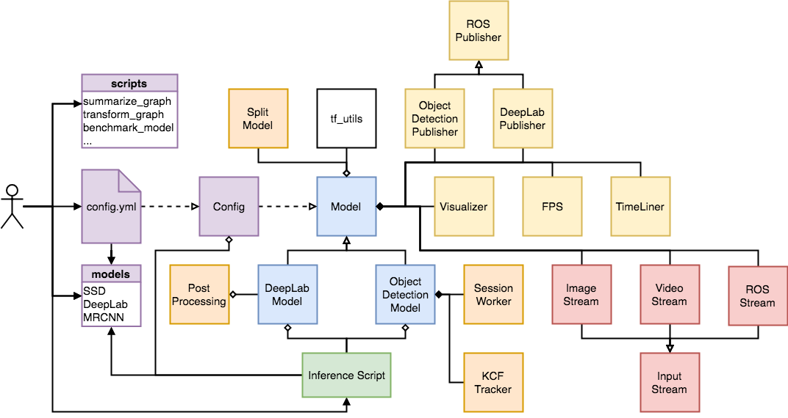

# Real-Time Object Detection

**Student Name:** Priyanshu Singh  
**Registration Number:** 23MIM10142

---

Real-time object detection based on TensorFlow's [Object Detection API](https://github.com/tensorflow/models/tree/master/research/object_detection) and the [DeepLab project](https://github.com/tensorflow/models/tree/master/research/deeplab).



## Project Overview

The goal of this project is to provide a scalable, real-time-capable object detection pipeline that can run on different systems with minimal setup.

The project includes:

- Optional downloading of pretrained TensorFlow models.
- Inference with OpenCV using video input or selected test images.
- Support for models from TensorFlow's `research/object_detection` and `research/deeplab` projects.
- An optional multithreaded CPU/GPU `ssd_mobilenet` speed optimization, which can improve performance depending on the system.
- Statistical testing on image sets, including mean and median FPS and standard deviation.
- Timeline files for measuring model-operation execution times.
- Scripts to inspect, summarize, quantize, transform, and benchmark models.
- Optional ROS integration for image-topic-based detection.

## Repository Versions and ROS Support

- **Version 1:** The [`r1.0` branch](https://github.com/GustavZ/realtime_object_detection/tree/r1.0) contains the original repository focused on high-performance `ssd_mobilenet` inference.
- **Version 2:** The [`master` branch](https://github.com/GustavZ/realtime_object_detection/tree/master) adds support for mask-detection models, KCF tracking, and DeepLab models.
- **ROS support:** Use the [`ros` branch](https://github.com/GustavZ/realtime_object_detection/tree/ros) to use this repository as a ROS package, or see [`objectdetection_ros`](https://github.com/GustavZ/objectdetection_ros).

## Inference

1. Copy `config.sample.yml` to `config.yml`.
2. Change configuration values in `config.yml` as needed. For example, set `VISUALIZE` to `False` to disable visualization or `SPLIT_MODEL` to `False` to disable the speed optimization.
3. To use KCF tracking, run `bash build_kcf.sh` and set `USE_TRACKER` to `True`. The original README notes that this currently works only with pure object-detection models when `SPLIT_MODEL` is disabled.

Example usage:

```python
from rod.model import ObjectDetectionModel, DeepLabModel
from rod.config import Config

model_type = "od"  # "od" for object detection or "dl" for DeepLab
input_type = "video"  # "video" or "image"

config = Config(model_type)
model = ObjectDetectionModel(config).prepare_model(input_type)
model.run()
```

Alternatively, run one of the provided scripts, such as `objectdetection_video.py`, `objectdetection_image.py`, `deeplab_video.py`, `deeplab_image.py`, or `allmodels_image.py`.

## Utility Scripts

1. Update paths and variables in `config_tools.sh` for your system.
2. On the first setup, run `source config_tools.sh`, then run `source build_tools.sh` once in the same terminal.
3. For later uses, run `source config_tools.sh`, then run the required script using `source script.sh` in that same terminal.

The original project documentation states that script output is logged to `test_results/`.

## Setup and Compatibility

The original repository documents this environment:

- Ubuntu 16.04
- Python 2.7
- TensorFlow 1.4
- OpenCV 3.3.1

These are legacy versions. Compatibility with modern operating systems and libraries may require additional changes. The original documentation also warns that TensorFlow 1.7.0 caused performance issues in its tested setup.

## Performance Reference

The original repository reported the following results for `ssd_mobilenet`:

- Dell XPS 15, Intel i7 at 2.80 GHz and GeForce GTX 1050 4 GB: **100 FPS**
- NVIDIA Jetson TX2, 8 GB: **30 FPS**

Actual performance depends on hardware, configuration, and model.

## Related Projects

- [`objectdetection_ros`](https://github.com/GustavZ/objectdetection_ros) — ROS integration.
- [`test_models`](https://github.com/GustavZ/test_models) — model benchmarking.
- [`deeptraining_hands`](https://github.com/GustavZ/deeptraining_hands) — hand-dataset setup and annotation conversion tools.
- [`yolo_for_tf_od_api`](https://github.com/GustavZ/yolo_for_tf_od_api) — YOLO v2 integration with TensorFlow's Object Detection API.
- [`realtime_segmenation`](https://github.com/GustavZ/realtime_segmenation) — project merged into version 2.
- [`Mobile_Mask_RCNN`](https://github.com/GustavZ/Mobile_Mask_RCNN) — a Keras model for mobile deployment.
- [`tf_training`](https://github.com/GustavZ/tf_training) — training Mobile Mask R-CNN models on AWS.
- [`tf_models`](https://github.com/GustavZ/tf_models) — TensorFlow models fork.
- [`eetfm_automation`](https://github.com/GustavZ/eetfm_automation) — automation for model export and evaluation.

## Credits

This README describes the existing `realtime_object_detection` project and links to its original upstream resources. Please retain appropriate attribution and follow the original repository's license when reusing or modifying the code.
